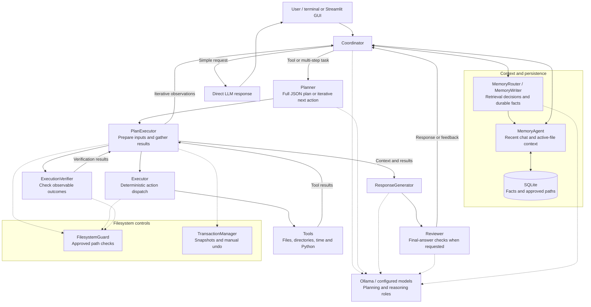

# Baby Claw

Baby Claw is a local Python/Ollama multi-agent assistant with both a terminal mode and a Streamlit GUI. The current version focuses on clearer agent separation, safe file execution, visible GUI tracing, and memory/context handling.

## Current Features

- Terminal and Streamlit GUI entry points.
- Short-term chat context and SQLite-backed long-term memory.
- Allows to manually view and delete current saved memories
- Choose a workspace anywhere on device
- Safety snapshots with GUI undo support.
- Live execution trace shown in the GUI for planner/executor runs.
- File upload support through `media_input/`.
- Python syntax verification before generated Python code is written.

### All available tools:

Executor actions:

- get_current_time -> get the current time.
- list_input_files -> list uploaded/input files from media_input.
- read_file -> read a file from media_input only. Use for uploaded or attached files.
- read_multiple_files -> read multiple uploaded/input files.
- list_directory -> list files/folders inside an approved workspace directory.
- view_file -> read a file from an approved workspace directory.
- find_file -> search for a file inside approved workspace directories.
- run_python_file -> run a Python file inside an approved workspace directory.
- create_file -> create a new file. 
- write_file -> overwrite an existing file.
- append_file -> append content to an existing file.
- edit_file -> modify an existing file in place.
- delete_file -> delete a file.
- delete_directory -> delete a directory and its contents.
- create_directory -> create a directory.
- move_path -> move a file or directory. 
- move_directory_contents -> move the contents inside one directory into another directory.
- copy_path -> copy a file or directory.
- rename_path -> rename a file or directory in place. 

Memory actions:

- get_first_user_prompt -> retrieve the first user prompt from short-term memory.
- get_last_user_prompt -> retrieve the most recent user prompt.
- get_short_term_context -> retrieve recent conversation context.
- get_last_active_file_name -> retrieve the active file name.
- get_last_active_file_content -> retrieve the active file content.
- get_previous_active_file_content -> retrieve the previous active file content.
- search_long_term_memory -> search saved long-term memory.
- list_recent_long_term_memories -> list recent saved memories. 
- delete_long_term_memory -> delete a saved memory by numeric ID.
- save_accessible_path -> save an approved accessible path.
- list_accessible_paths -> list saved accessible paths.
- revoke_accessible_path -> remove a saved accessible path. 


## Directory Decomposition

```text
src/
├── action_constants.py        # shared action names and action groups
├── backend_factory.py         # builds and wires the backend agents
├── config.py                  # model and runtime defaults
├── filesystem_guard.py        # approved workspace path checks
├── gui_app.py                 # Streamlit GUI, chat state, task process handling
├── main.py                    # terminal entry point
├── ollama_client.py           # Ollama chat wrapper
├── paths.py                   # shared project paths
├── prompts.py                 # system prompts for routing, planning, memory, review
├── reasoning_settings.py      # reasoning mode and iteration settings
├── assets/
│   ├── gui.css                # GUI styling
│   ├── gui.js                 # GUI browser-side helpers
│   └── header.html            # GUI header markup
└── agents/
    ├── __init__.py            # agent package exports
    ├── coordinator.py         # top-level router and workflow controller
    ├── executor/
    │   ├── __init__.py
    │   ├── executor.py        # dispatches low-level actions
    │   └── tools/
    │       ├── __init__.py
    │       ├── datetime_tools.py
    │       ├── directory_tools.py
    │       ├── file_tools.py
    │       └── transaction_manager.py
    ├── memory/
    │   ├── __init__.py
    │   ├── memory.py          # short-term context and active file state
    │   ├── memory_router.py   # decides when stored memory is needed
    │   ├── memory_store.py    # SQLite persistence layer
    │   └── memory_writer.py   # extracts durable memory candidates
    ├── planner/
    │   ├── __init__.py
    │   ├── plan_executor.py   # resolves paths and executes planner actions
    │   ├── planner.py         # converts requests into actions
    │   └── response_generator.py
    └── reviewer/
        ├── __init__.py
        ├── reviewer.py        # final answer review
        └── execution_verifier.py
```

## Runtime Flow

1. `main.py` or `gui_app.py` sends the user prompt to the `CoordinatorAgent`.
2. The coordinator stores short-term context and decides whether the request is simple or needs the planning pipeline.
3. Simple prompts are answered directly with recent context.
4. Complex prompts go through the Planner, PlanExecutor, Executor, and Reviewer.
5. File actions are restricted by `filesystem_guard.py` and verified after execution.
6. The GUI runs agent work in a child process and passes recent chat messages into that process to preserve follow-up context.
7. For filesystem changes, snapshots are recorded so the GUI can undo the latest change set.

## Running

Install the Python dependencies:

```bash
python -m pip install -r requirements.txt
```

Start Ollama locally before running BabyClaw. The models used by the app are configured in `src/config.py`:

- `BABYCLAW_PLANNING_MODEL` -> planner model, defaults to `gemma4`
- `BABYCLAW_REASONING_MODEL` -> reasoning/reviewer model, defaults to `gpt-oss:20b`

You can change those defaults by editing `src/config.py`, setting environment variables, or adding a `.env` file at the project root:

```bash
BABYCLAW_PLANNING_MODEL=gemma4
BABYCLAW_REASONING_MODEL=gpt-oss:20b
BABYCLAW_PYTHON_RUN_TIMEOUT=10     # seconds; raise for slow scripts
BABYCLAW_MAX_ITERATIVE_STEPS=50    # iterative-mode step cap before BabyClaw stops
```

Make sure the configured Ollama models are installed:

```bash
ollama pull <planning-model>
ollama pull <reasoning-model>
```

Run the terminal app:

```bash
python src/main.py
```

Run the Streamlit GUI:

```bash
streamlit run src/gui_app.py
```

If port `8501` is busy, run Streamlit directly with another port:

```bash
streamlit run src/gui_app.py --server.port=8502
```

Optional remote Ollama host:

```bash
export OLLAMA_HOST_URL="http://<remote-host>:11434"
```

## Architecture

The coordinator routes requests and manages context. Simple requests receive a direct LLM response; tasks requiring tools use the planning and execution pipeline.



- Solid arrows show the main request, result and context flow; dotted arrows show supporting checks or model calls.
- In iterative mode, the coordinator feeds observations back to the planner and selects the next action until completion or a stopping condition. The diagram groups the components; not every request passes through response generation or review.
- Memory retrieval is SQLite-backed phrase/keyword matching, not embedding-based vector search.
- The filesystem guard checks approved paths, while snapshots support manual recovery. These controls are not an operating-system sandbox for executed Python code.
